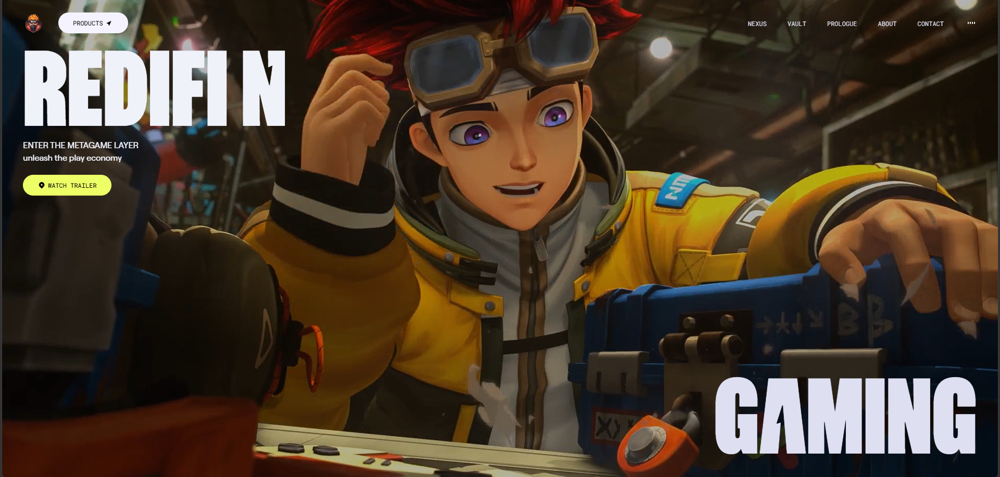

# Zentry Gaming Website Clone

## Overview

This project is a recreation of the Zentry gaming website, designed to showcase how to build a highly interactive and visually stunning web experience. It takes complex design concepts, like advanced scroll-based animations and parallax effects, and brings them to life in a smooth, performant way, offering a premium feel often seen in cutting-edge digital platforms.

## Description

Dive into a high-fidelity clone of the Awwwards-winning Zentry website, meticulously crafted to deliver an immersive and dynamic user experience. This project goes beyond static pages, integrating sophisticated scroll animations, parallax effects, and modern UI elements to create an engaging journey through a fictional gaming universe. It's a testament to building polished, interactive frontends that capture attention and push the boundaries of web design.

## Installation

Getting this project up and running locally is straightforward.

1.  **Clone the Repository**:

    ```bash
    git clone https://github.com/numcodes/zentry-clone.git
    cd zentry-clone
    ```

2.  **Install Dependencies**:
    Navigate into the project directory and install the necessary packages using npm or yarn:

    ```bash
    npm install
    # or
    yarn install
    ```

3.  **Run the Development Server**:
    Start the development server to view the project in your browser:

    ```bash
    npm run dev
    # or
    yarn dev
    ```

    The application will typically be available at `http://localhost:5173` (or another port if 5173 is in use).

## Usage

Once the development server is running, open your browser to the local address provided (e.g., `http://localhost:5173`). You'll be greeted with the interactive Zentry website clone.

*   **Explore**: Scroll through the different sections to experience the unique animations, parallax effects, and visual transitions.
*   **Interact**: Pay attention to the subtle hover effects, the video backgrounds in the Bento grid, and the dynamic title animations.
*   **Hero Section**: The hero section features interactive video elements and a "WATCH TRAILER" button. The small video in the top-left corner changes the main video when clicked.
*   **Navigation**: Use the navigation bar at the top to jump between main sections like "About," "Features," "Story," "What We Do," and "Contact Us."
*   **Audio Toggle**: Click the audio indicator in the navigation bar to toggle background music on or off.

**Preview**



## Features

*   **Modern Component Architecture**: Built with React, leveraging a modular design for distinct sections like Hero, Features, Story, and About Us.
*   **Unique Scroll Animations**: Custom, scroll-triggered effects powered by GSAP (GreenSock Animation Platform) for a dynamic and engaging user experience.
*   **Fluid Smooth Scrolling**: Integrated Locomotive Scroll via a custom context provider (`SmoothScrollProvider`) for seamless, high-performance scrolling across all sections.
*   **Hover & Interactive Effects**: Dynamic parallax elements using `react-parallax-mouse` and sleek transitions enhance user engagement.
*   **Responsive Utility Styling**: Striking layouts and a futuristic aesthetic rapidly built with Tailwind CSS, ensuring a consistent experience across devices.
*   **Optimized Performance**: Blazing fast loading and efficient module bundling powered by Vite, a modern build tool.
*   **Dynamic Video Integration**: Interactive video backgrounds and switchable video elements in the hero section and features grid.
*   **Custom Typography**: Utilizes custom fonts (`zentry`, `general`, `circular-web`, `robert-medium`, `robert-regular`) for a unique brand identity.

## Technologies Used

| Technology             | Description                                          |
| :--------------------- | :--------------------------------------------------- |
| **React.js**           | Component-based frontend library with TypeScript     |
| **TypeScript**         | Superset of JavaScript that adds static types        |
| **Vite**               | Next-generation frontend tooling                     |
| **Tailwind CSS**       | Utility-first CSS framework for rapid UI development |
| **GSAP (GreenSock)**   | Industry-standard JavaScript animation library       |
| **ScrollTrigger**      | GSAP plugin for scroll-based animations              |
| **Locomotive Scroll**  | Custom scroll library for smooth scrolling effects   |
| **react-parallax-mouse** | React component for mouse-controlled parallax effects |
| **React Icons**        | Customizable SVG React icons                         |
| **ESLint**             | Pluggable JavaScript linter                          |
| **Prettier**           | Code formatter                                       |

## Contributing

We welcome contributions to this project! If you have suggestions for improvements, new features, or bug fixes, please follow these steps:

1.  **Fork the repository**: Click the "Fork" button at the top right of this page.
2.  **Clone your forked repository**:
    ```bash
    git clone https://github.com/numcodes/zentry-clone.git
    ```
3.  **Create a new branch**:
    ```bash
    git checkout -b feature/your-feature-name
    ```
    or
    ```bash
    git checkout -b bugfix/issue-description
    ```
4.  **Make your changes**: Implement your feature or fix the bug.
5.  **Commit your changes**:
    ```bash
    git commit -m "feat: Add new feature"
    # or
    git commit -m "fix: Resolve bug with X"
    ```
6.  **Push to your branch**:
    ```bash
    git push origin feature/your-feature-name
    ```
7.  **Open a Pull Request**: Go to the original repository on GitHub and open a new pull request, clearly describing your changes.

Please ensure your code adheres to the existing coding style and includes appropriate tests where necessary.

## License

This project is licensed under the MIT License.


## Author Info

*   **Num Codes**
* <a href="https://wa.me/+2349037910725" title="WhatsApp" target="_blank">
  
</a>

*   [Ugochukwu Nweze](https://www.linkedin.com/in/ugochukwu-nweze-08812a2b8)
*   [@CodesNum80638](https://x.com/CodesNum80638)
---

[](https://react.dev/)
[](https://www.typescriptlang.org/)
[](https://vitejs.dev/)
[](https://tailwindcss.com/)
[](https://gsap.com/)

---
