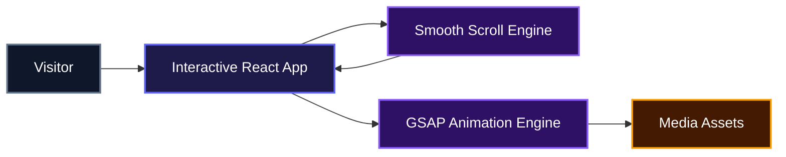
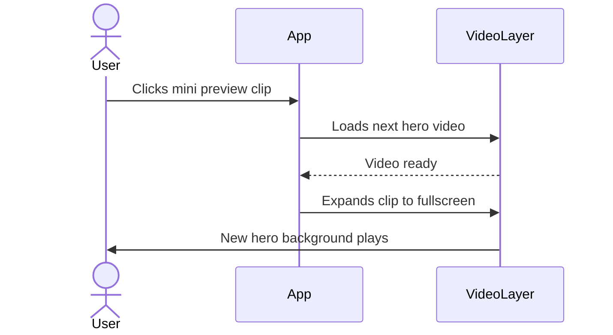
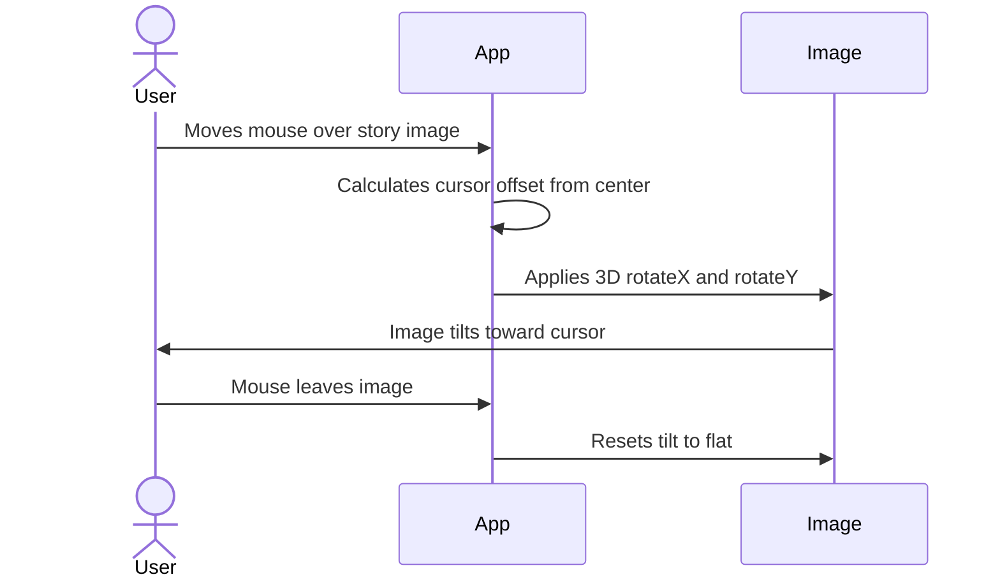

# Zentry Gaming Website Clone

## Description

A polished, single-page marketing experience that recreates the look and feel of the Zentry gaming universe. It is built to demonstrate how a developer can turn a bold visual design into a living, scrollable, and interactive website.

## Overview

Zentry helps developers showcase high-impact gaming and entertainment brands through one continuous, animated landing experience. It combines full-screen video, scroll-driven scene changes, and reactive mouse effects into a page that feels like a native product reveal. Teams can use it as a starting point for any campaign that needs to keep visitors scrolling and exploring.

## System Architecture



## Features

- **Cinematic hero section** with switchable full-screen video loops and a custom loading spinner.
- **Scroll-driven pinned storytelling** that locks the viewport while text points reveal in sequence.
- **Mouse-reactive 3D tilt** on the story image based on cursor position.
- **Smooth inertial scrolling** across the entire page for a premium navigation feel.
- **Animated headings** that flip into view as they enter the viewport.
- **Audio toggle** for background ambience directly from the navbar.
- **Bento-style features grid** with hover-tilt cards and looping video backgrounds.
- **Responsive layout** that adapts cleanly from mobile to desktop.

### Cinematic Hero Video Switching

Clicking the small preview clip swaps the main hero background with a smooth fullscreen expansion.



### 3D Story Image Tilt

Moving the cursor over the story image creates a live 3D perspective shift.



## Installation

1. Clone the repository:

```bash
git clone https://github.com/numcodes/zentry-clone.git
cd zentry-clone
```

2. Install dependencies:

```bash
npm install
```

3. Start the development server:

```bash
npm run dev
```

The site will be available at `http://localhost:5173` by default.

## Usage

Open `http://localhost:5173` in your browser and scroll through the page.

- Click the small preview video in the hero to swap the main background clip.
- Hover over the story image to see the live 3D tilt effect.
- Use the audio indicator in the navbar to toggle background ambience.
- Navigate between sections using the navbar links.


## Technologies Used

| Technology | Description |
| :--- | :--- |
| [React](https://react.dev/) | Component-based UI library |
| [TypeScript](https://www.typescriptlang.org/) | Typed JavaScript for safer code |
| [Vite](https://vitejs.dev/) | Fast build tool and dev server |
| [Tailwind CSS](https://tailwindcss.com/) | Utility-first styling |
| [GSAP](https://gsap.com/) | Advanced animations and scroll triggers |
| [Locomotive Scroll](https://locomotivemtl.github.io/locomotive-scroll/) | Smooth, inertial scrolling |
| [React Icons](https://react-icons.github.io/react-icons/) | SVG icon library |

## Contributing

Contributions are welcome. Feel free to fork the repository, create a feature branch, and open a pull request with your changes.

## Author

- LinkedIn: [Ugochukwu Nweze](https://linkedin.com/in/ugochukwu-nweze-08812a2b8)
- X: [@CodesNum80638](https://x.com/CodesNum80638)

## Badges

[](https://react.dev/)
[](https://www.typescriptlang.org/)
[](https://vitejs.dev/)
[](https://tailwindcss.com/)
[](https://gsap.com/)
